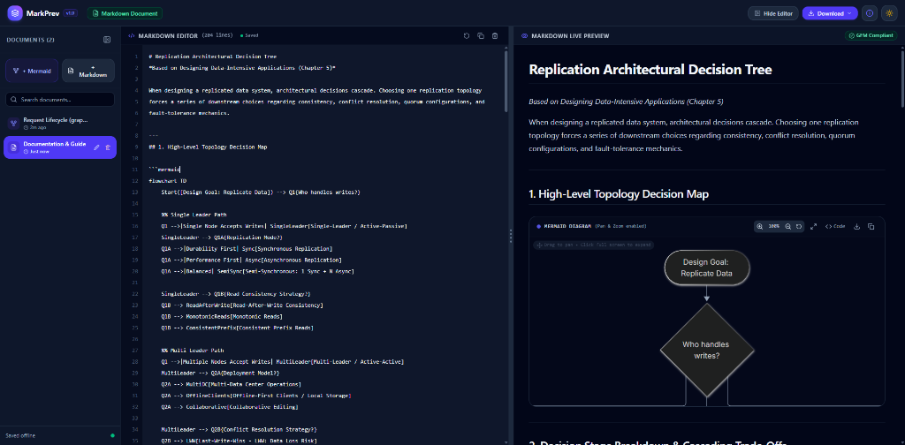

# MarkPrev — Live Mermaid & Markdown Previewer

<p align="center">
  
</p>

<p align="center">
  <strong>A high-performance, offline-first live editor and previewer for Mermaid diagrams and GitHub Flavored Markdown.</strong>
</p>

<p align="center">
  
  
  
  
  
  
  
</p>

---

## ✨ Features

- **⚡ Real-Time Split Preview**: Fluid 50/50 resizable split view with draggable center divider and double-click to re-center.
- **📊 Embedded Mermaid in Markdown**: Seamlessly write and render ```` ```mermaid ```` code blocks inside markdown documents with full syntax highlighting.
- **🔍 Interactive Pan, Zoom & Fullscreen**:
  - Pan by dragging the diagram canvas.
  - Zoom in/out with precision controls or double-click to reset.
  - In-app **Full Screen modal** expansion for complex, large-scale architectures.
- **👁️ Focus & Presentation Mode**: One-click **Hide Editor** toggle in the header that expands the live preview to 100% width for distraction-free reading or presenting.
- **💾 100% Offline Persistence**:
  - Multi-document management (Create, Rename, Delete, Switch) backed by browser **IndexedDB** (`markprev-db`).
  - View states, split ratio, editor visibility, and theme preferences saved automatically in `localStorage`.
- **🎨 High-DPI Lossless Export**:
  - **SVG Vector Image**: Infinite zoom, perfect for documentation and vector editors.
  - **High-DPI PNG**: Crisp 3x and 4x resolutions (300+ DPI quality).
  - **Raw Code**: Export `.md` or `.mmd` source files directly.
- **🛡️ Real-Time Syntax Validation**: Instant syntax linting and diagnostic feedback when invalid Mermaid diagram syntax is entered.
- **🌓 Dark & Light Modes**: Seamless switching with custom Tailwind v4 palette.
- **📖 In-App Styling Cheat Sheet**: Built-in interactive cheat sheet covering GFM tables, task lists, code blocks, and Mermaid flowchart/sequence/state diagram syntax.

---

## 🚀 Getting Started

### 1. Prerequisites
Ensure you have [Node.js](https://nodejs.org/) (version 18 or higher) installed.

### 2. Install Dependencies
```bash
npm install
```

### 3. Start Development Server
```bash
npm run dev
```
Open [http://localhost:5173/](http://localhost:5173/) in your browser.

### 4. Run Automated Test Suite
```bash
npm test
```
Runs unit and integration tests across storage, export services, split pane, editor toggles, and Mermaid validator suites.

### 5. Check Linting
```bash
npm run lint
```

### 6. Build for Production
```bash
npm run build
```
Generates a minified, production-ready static bundle in the `dist/` directory.

---

## 🏗️ Project Architecture

```
markprev/
├── docs/
│   └── screenshots/         # UI showcase screenshots
│       └── markprev-preview.png
├── public/
│   └── favicon.svg          # Custom SVG favicon
├── src/
│   ├── components/
│   │   ├── editor/          # Code editor panel & status bar
│   │   ├── layout/          # Header, Sidebar, ResizableSplitPane
│   │   ├── modals/          # Help & styling guide modal
│   │   └── preview/         # Live Markdown & Mermaid preview with pan/zoom
│   ├── services/
│   │   ├── exportService.ts # SVG & High-DPI PNG generation
│   │   ├── mermaidValidator.ts # Mermaid syntax validation
│   │   └── storage.ts       # IndexedDB database service
│   ├── types/               # TypeScript data models & schemas
│   ├── App.tsx              # Application root state & layout orchestration
│   └── main.tsx             # React DOM entry point
└── package.json
```

---

## 🌐 Deploy to Vercel

MarkPrev is a 100% client-side Single Page Application (SPA) with zero external database dependencies. It deploys to **Vercel** effortlessly:

1. Push this repository to GitHub.
2. Sign in to [Vercel](https://vercel.com) and click **"Add New Project"**.
3. Import your GitHub repository.
4. If your project is inside a subfolder, set the **Root Directory** to `markprev`.
5. Vercel automatically detects the Vite configuration:
   - **Framework Preset**: `Vite`
   - **Build Command**: `npm run build`
   - **Output Directory**: `dist`
6. Click **Deploy**. Your live previewer is instantly deployed worldwide on Vercel's Edge Network!

---

## 📄 License

MIT © [MarkPrev](https://github.com)


## Plan of agent dev

# Internal-Docs Agentic Assistant — Build Plan

Oct 25, 2026 · @azizul

One system teaches five of the six AI-engineering skills: a RAG assistant over internal docs (design docs, PRDs, business docs), fronted by an agent, cached semantically, protected by guardrails, and measured by an eval harness fed synthetic data. A trace layer records cost and latency across all of it. LoRA stays a separate, optional one-off. Everything runs on your GCP experimental project / Google workstation, built on the Vertex AI, Gemini and ADK stack — no third-party tools like Pinecone.

This is not a seventh track competing with your 2027 plan. DS&A fluency and system design stay first; this runs at low cadence, through your learn-anything habit, and yields whenever interview prep or a weekend window is tight. Its payoff is a single production-shaped system you can defend in an interview, rather than six disconnected demos — and the observability and caching pieces lean directly on the DDIA and system-design study you're already doing.

The book reference throughout is *AI Engineering* by Chip Huyen (O'Reilly, 2025). Each component below names the exact sections to read, so you never read the book line by line.

## Architecture at a glance

&#91;embedded content: request flow · 4 stages, 2 shared layers\]

A request hits the input guardrail, checks the semantic cache, and on a miss goes to the agent, which decides whether to retrieve, call a tool, or answer. The output passes the guardrail again before returning. The eval harness and the trace layer sit under every request. Build the stages roughly right-to-left (retrieval first, since everything depends on it), but wire the eval and trace layers in from day one.

## The six components

## 1. RAG — hybrid search over internal docs

**Skill:** retrieval architecture, chunking, hybrid search, reranking.

**Build:** on the GCP experimental project, ingest your design docs, PRDs and business docs (parse the layout-heavy ones with Document AI), chunk them, embed with the Gemini text-embeddings API, and index into Vertex AI Vector Search. Serve a `/query` endpoint on Cloud Run that does hybrid retrieval, reranks with the Vertex AI Ranking API (the `semantic-ranker` models), and returns passages with citations. Vertex AI RAG Engine can manage the ingest → embed → retrieve → rank loop end to end if you'd rather start higher-level. This is the foundation — every other component sits on top of it.

**Where the signal is:** "RAG over internal docs" is the most common portfolio project in AI engineering, and on Vertex the managed path makes the plumbing even less of a differentiator. What *will* set you apart: chunking strategy for *structured* docs (a PRD is not a blog post — headings, tables, requirement IDs all matter), table handling, citation accuracy, and freshness when a doc changes. Spend your effort there, not on the wiring.

**Hand-rolled vs managed:** build it hand-wired once (Vector Search + Ranking API assembled yourself) so you understand each stage, then know the managed Vertex AI RAG Engine path for production. "I built it both ways, here's the trade-off" is itself senior signal. (Note the current rebrand: RAG Engine and these APIs also appear under the Gemini Enterprise Agent Platform — same tools, your Gemini Enterprise cert territory.)

**Read in Huyen — Chapter 6 (RAG and Agents), RAG half only:** the RAG architecture overview, retrieval algorithms (term-based vs embedding-based), hybrid search, chunking strategy, and reranking. Read it for the concepts, then map each onto its Vertex equivalent (embedding-based retrieval → Vector Search, reranking → Ranking API). Skip the agents half for now; it comes back in Component 2.

## 2. Agent layer

**Skill:** tool use, planning, reflection, memory, agent failure modes.

**Build:** an ADK agent (deployed to Vertex AI Agent Engine, the same path you already use at work) in front of the RAG endpoint that decides, per query, whether to retrieve, call a tool (e.g. the text-to-SQL tool from Component 4), or answer directly. Add retry and recovery when a step fails, and a small memory for multi-turn context.

**Where the signal is — and the trap:** you already orchestrate multi-agent systems with ADK at work, so building a from-scratch agent loop has low *learning* value for you. Don't rebuild what you do daily. Push instead into the parts you probably haven't owned end to end: agent-level evaluation (does the agent choose the right action?), failure recovery and retries, memory design, and cost control per decision. That's the senior gap, and it connects straight to Components 5 and 6.

**Read in Huyen — Chapter 6, agents half:** the agent overview, tools and planning, reflection and error correction, and the agent-failure taxonomy. The failure taxonomy is the most useful part for you — it gives you the vocabulary to design on purpose instead of by trial and error.

## 3. Semantic cache (LLMOps)

**Skill:** LLMOps — caching, cost and latency reduction.

**Build:** a cache layer in front of the agent. On a new query, embed it with the Gemini embeddings API, check vector similarity against cached queries (Memorystore for Redis, or a small Vector Search index), and return the stored answer on a hit above a threshold. Handle invalidation when source docs change, and staleness (a cached answer can be subtly wrong after an edit).

**Why it's a good pick for you:** it plays directly to your backend and distributed-systems strengths — similarity thresholds, cache invalidation, staleness risk, cost/latency trade-offs are exactly the caching topics already in your DDIA and backend-upskilling study. The caveat: semantic caching is *one slice* of LLMOps, not the whole thing (routing, deployment, monitoring, cost tracking are all part of it too). Fine as a single project — just don't mistake it for the full topic. Some of the rest shows up in Component 6.

**Read in Huyen — Chapter 9 (Inference Optimization)** for the latency and cost metrics (TTFT, TPOT) and the caching section, and **Chapter 10** for where caching sits in a full architecture (the model-gateway and caching parts). You only need the caching-relevant sections of ch. 9, not quantization or parallelism.

## 4. Guardrails — text-to-SQL

**Skill:** defensive prompting, input/output guardrails, safe tool use.

**Build:** a text-to-SQL tool the agent can call against BigQuery, wrapped in guardrails. Input guard: Model Armor for prompt-injection and jailbreak detection on the incoming request. Output guards: block destructive SQL (no DROP/DELETE/UPDATE), enforce row limits, scope to allowed datasets/tables, and strip PII (Model Armor's Sensitive Data Protection). Run read-only against a sample BigQuery dataset.

**Where the signal is:** text-to-SQL by itself is a near-solved demo, so it won't carry the project — the rigor of the guardrails and how you *evaluate* them is what matters. Your agents already read help-center content and user data, so prompt injection is a real risk in your actual work, not a theoretical one. This component ties to your gRPC/data work too.

**Read in Huyen — Chapter 5 (Prompt Engineering)** for the defensive-prompting section (jailbreaks and prompt injection) — that's the core of the input guard. Then **Chapter 10** for the guardrails part of the production architecture (input and output guardrails as a system component).

## 5. Eval harness + synthetic dataset generator — do this one well

**Skill:** evaluation methodology, AI-as-a-judge, dataset engineering.

**Build:** an offline harness that scores the system — retrieval quality (did it fetch the right passages?), answer quality (AI-as-a-judge via the Vertex AI Gen AI Evaluation Service, or Gemini as the judge), and guardrail effectiveness (did Model Armor block what it should?). Feed it with a synthetic dataset generator that uses Gemini to produce question/answer pairs from your internal docs, so you can test at scale instead of hand-writing cases.

**Why this is the best pick in the set:** evaluation is the skill most people skip, it's exactly what your "Evaluate and Improve ADK Agents" certification points at, and synthetic eval-data generation is genuinely differentiating. It's also the component that makes every other one measurable — without it, you can't prove any of the others work. Build it early and wire each new component into it as you go.

**Read in Huyen — three chapters, in order:** **Chapter 3 (Evaluation Methodology)** for the metrics and AI-as-a-judge fundamentals; **Chapter 4 (Evaluate AI Systems)** for designing an eval pipeline and choosing criteria; **Chapter 8 (Dataset Engineering)** for the synthetic-data-generation section specifically. These three are the backbone of this component.

## 6. Observability / trace layer — the "harness 2" addition

**Skill:** production observability, cost and latency tracking (the rest of LLMOps).

**Build:** a trace layer every request logs into — Cloud Trace + Cloud Logging + Cloud Monitoring, plus the tracing ADK and Agent Engine emit out of the box. Per request, record: retrieval hits, which agent step ran, cache hit/miss, guardrail trips, token cost, and latency breakdown (TTFT, total). Surface it on a dashboard (Cloud Monitoring, or Looker Studio over the logs).

**Why add it:** this is the piece that turns six demos into something you can talk about like a production system. When a Google interviewer asks "how do you know this works, and what does it cost?", the trace layer is your answer. It's cheap to build if you design it in from the start and expensive to retrofit — so wire it in from day one, even before it's pretty. It leans directly on the observability and caching topics already in your backend-upskilling and DDIA study, which is why it's worth the small extra scope over the five you listed.

**Read in Huyen — Chapter 10 (AI Engineering Architecture and User Feedback):** the observability section and the step-by-step build-up of the production architecture (context → guardrails → router/gateway → cache → observability). This chapter is also your template for an end-to-end AI system-design interview answer.

## LoRA — optional, standalone, do it once

**Skill:** finetuning (when to, and when not to).

This is the one skill that does *not* fold into the combined system, and the lowest-value one for your goals. Huyen's own argument is that most teams shouldn't finetune, and as an agentic AI engineer you'll rarely need it. On the GCP project the infrastructure is there — Vertex AI tuning / custom training with GPU or TPU — so the blocker isn't resources; it's that this is simply the highest-effort, lowest-payoff of the six for where you're headed.

**So:** do it *once*, small — one supervised-tuning / LoRA run on Vertex AI against a small open model, enough to understand what LoRA is and when to reach for it. Don't build a whole "pipeline." The valuable takeaway is the judgment to say "here's why RAG or prompting beats finetuning here," which is an architecture decision seniors are expected to defend.

**Read in Huyen — Chapter 7 (Finetuning):** the "finetuning vs alternatives" decision framing first (that's the part that matters), then skim PEFT/LoRA and the memory-math section. You don't need model merging.

## Build sequence

Low cadence. This is weekend-and-small-windows work that yields to DS&A and system design whenever those need the time. Rough order, each phase a couple of weekends, not a deadline:

1. **Eval harness skeleton + synthetic generator (Component 5).** Build this first, even minimal — Gen AI Evaluation Service + Gemini-generated Q/A pairs. It makes everything after it measurable. Read Huyen ch. 3, then ch. 8's synthetic-data section.
2. **RAG endpoint (Component 1), with an eval attached from day one.** Vector Search + Ranking API on Cloud Run (or RAG Engine). Read ch. 6 RAG half. Hook it into the harness so you see retrieval scores immediately.
3. **Observability / trace layer (Component 6).** Cloud Trace + Logging + Monitoring, wired in now while the system is small — retrofitting later is the expensive path. Read ch. 10.
4. **Guardrails + text-to-SQL (Component 4).** Model Armor on input/output, BigQuery as the target. Read ch. 5 defensive-prompting + ch. 10 guardrails. Evaluate the guards with the harness.
5. **Agent layer (Component 2), only the parts beyond what you already do.** ADK on Agent Engine. Read ch. 6 agents half. Focus on agent-level eval, recovery, memory, cost.
6. **Semantic cache (Component 3).** Memorystore + Gemini embeddings. Read ch. 9 caching + ch. 10. Measure the cost/latency win on the trace layer.
7. **LoRA (optional, standalone).** One small Vertex AI tuning run if and when you have the time. Read ch. 7's decision framing.

**The rule:** when interview prep or a tight week competes, this pauses — it never displaces DS&A problem-solving or system-design reading. It's real project experience for the AI-agent track you keep on the job, not a separate career path.

## How to read Huyen without reading it line by line

Reading cover to cover is the slowest way to learn this, and for a working engineer usually the wrong one. Four habits:

- **Read for structure, not lines.** Per chapter: intro, scan the headers, read the summary — ten minutes, and you have a map. Then deep-read *only* the sections a component needs. The book becomes a reference you pull from, not a novel you finish.
- **Let the project pull the reading.** Read a concept, then immediately hit the wall it describes in your build, then reread — that's the highest-retention path by far. The per-component "Read in Huyen" notes above are built for exactly this.
- **Active recall beats rereading.** After a section, close the book and write five bullets from memory, or explain it aloud as if to a colleague. The struggle to recall is what builds the memory; rereading feels productive and mostly isn't.
- **Anchor to systems you already run.** For each concept ask "where does this show up in my ADK agents or the chat product?" That turns reading into recognition, which is faster than learning cold.

**One honest note on how you work:** you write \~80–90% of your code with agents, which is fine for shipping. For *learning* these fundamentals, flip the ratio. Let an agent build all six and you'll have six repos and little knowledge — and a Google interview finds that gap fast. Use AI as a Socratic tutor here (have it quiz you, poke holes in your explanations, generate edge cases), but write your own answers first.

